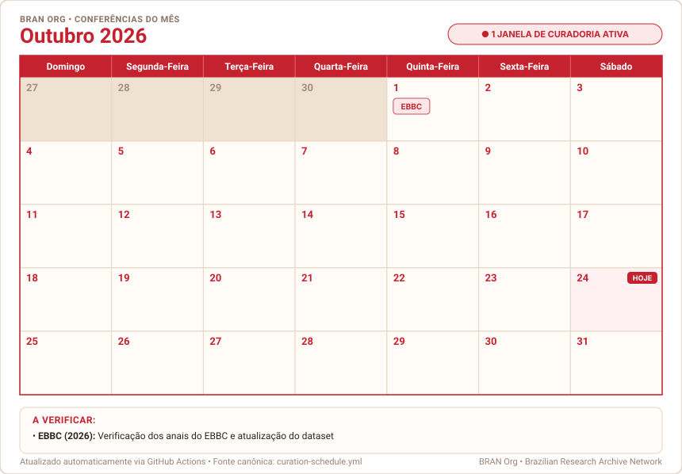

# Calendário de Curadoria e Governança de Dados — BRAN Org

<p align="center">
  <a href="https://github.com/BRAN-Org"></a>
  <a href="calendar.ics"></a>
  <a href=".github/workflows/calendar-ci.yml"></a>
</p>

Repositório central de governança, automação e geração dos calendários de conferências e curadoria de dados abertos da **[BRAN Org](https://github.com/BRAN-Org)**.

---

## Conferências do Mês (Tempo Real)

Este card reflete o mês corrente, destacando o dia atual (**HOJE**), a conferência ativa do mês e as instruções da equipe:

<p align="center">
  
</p>

---

## Como Incorporar este Calendário em Outros Repositórios

Para exibir o calendário do mês em qualquer README da organização (como `.github`, `.github-private` ou repositórios de bases), basta colar o snippet abaixo:

```markdown
### Conferências do Mês

<p align="center">
  <a href="https://github.com/BRAN-Org/calendar_config">
    
  </a>
</p>
```

> 💡 **Sincronização Automática:** O link aponta fixamente para `assets/current.svg`. Todo dia 1º do mês, o GitHub Actions deste repositório recalcula o mês vigente e atualiza o `current.svg`. Com isso, **todos os READMEs da organização atualizam automaticamente** sem necessidade de commits manuais.

---

## 1. Assinatura no Google Agenda / Apple Calendar

Você pode assinar o feed `.ics` para receber notificações nativas no seu aplicativo de calendário habitual:

- **URL de Inscrição Direta:**
  ```text
  https://raw.githubusercontent.com/BRAN-Org/calendar_config/main/calendar.ics
  ```

### Como Adicionar no Google Agenda:
1. Abra o [Google Agenda](https://calendar.google.com).
2. Na barra lateral esquerda, em **"Outras agendas"**, clique em **`+`** > **"Do URL"** (*From URL*).
3. Cole a URL acima e clique em **"Adicionar agenda"**.

---

## 2. Acervo dos 12 Meses do Ano

Os SVGs em grade de todos os meses do ano ficam pré-compilados na pasta [`assets/months/`](assets/months/):

| Mês | Arquivo SVG | Status Típico / Conferências |
| :--- | :--- | :--- |
| **Janeiro** | [`01-janeiro.svg`](assets/months/01-janeiro.svg) | Curadoria pós-evento ENANCIB e ABEC Meeting |
| **Fevereiro** | [`02-fevereiro.svg`](assets/months/02-fevereiro.svg) | Em dia / Sem janelas críticas |
| **Março** | [`03-marco.svg`](assets/months/03-marco.svg) | Em dia / Sem janelas críticas |
| **Abril** | [`04-abril.svg`](assets/months/04-abril.svg) | Em dia / Sem janelas críticas |
| **Maio** | [`05-maio.svg`](assets/months/05-maio.svg) | Em dia / Sem janelas críticas |
| **Junho** | [`06-junho.svg`](assets/months/06-junho.svg) | Em dia / Sem janelas críticas |
| **Julho** | [`07-julho.svg`](assets/months/07-julho.svg) | Auditoria de integridade fria: **DataGramaZero** (`DGZero`) |
| **Agosto** | [`08-agosto.svg`](assets/months/08-agosto.svg) | Em dia / Sem janelas críticas |
| **Setembro** | [`09-setembro.svg`](assets/months/09-setembro.svg) | Janela bienal: **EBBC** (anos pares) |
| **Outubro** | [`10-outubro.svg`](assets/months/10-outubro.svg) | Janela bienal: **EBBC** (anos pares) |
| **Novembro** | [`11-novembro.svg`](assets/months/11-novembro.svg) | Em dia / Sem janelas críticas |
| **Dezembro** | [`12-dezembro.svg`](assets/months/12-dezembro.svg) | Janela anual: **ENANCIB** e **ABEC** |

---

## 3. Como Funciona o CI/CD

O workflow [`.github/workflows/calendar-ci.yml`](.github/workflows/calendar-ci.yml) é o motor de automação:

1. **Cron Mensal (`0 12 1 * *`)**: Roda no dia 1º de cada mês.
2. **Geração de Assets**: Recompila `calendar.ics`, todos os 12 SVGs e atualiza `assets/current.svg`.
3. **Disparo de Issues**: Avalia se há conferências ativas para o mês no [`curation-schedule.yml`](curation-schedule.yml) e abre uma Issue neste repositório atribuída ao mantenedor, com checklist de execução.
4. **Push Automático**: Qualquer ajuste no `curation-schedule.yml` recompila automaticamente todo o acervo.
